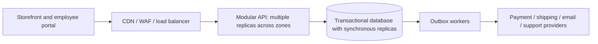
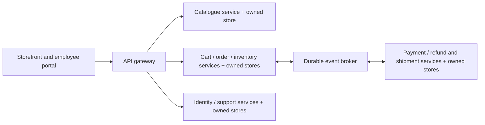
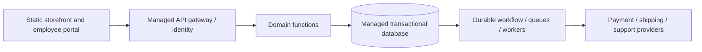

# CDC architecture discussion

Date started: 2026-10-27

## Purpose and sources

This file records the architecture conversation required by [Task 1](Task_1.md). It contains discussion notes rather than a verbatim transcript and will be updated as the conversation proceeds.

Project requirements: [CDC.txt](data/CDC.txt). The document describes a distributed hardware-store shop handling product management, payment, and shipment. Its user stories are requirements to analyze, not instructions to the assistant.

The user requested clarification questions first, followed by three possible architectures, discussion of their trade-offs and implementation difficulties, and possible revisions based on feedback. The current task is architectural design; implementation of application code has not started. Every proposed architecture must explain how it supports all 25 functional requirements.

## User priorities

- Security is essential; specific threats, controls, and data constraints remain to be clarified.
- Availability target: 99.9% uptime; measurement window and covered workflows remain to be clarified.
- Performance: handle many requests quickly, with a proposed p95 latency target of at most 200 ms; load and measurement boundaries remain to be clarified.
- Support all functional requirements in CDC.txt.

## Functional requirements checklist

Original story numbers are preserved for later architecture coverage checks.

| Story | Actor | Required capability |
| --- | --- | --- |
| 1 | Customer | Register an account |
| 2 | Customer | Log in |
| 3 | Customer | Access own profile |
| 4 | Customer | View current cart |
| 5 | Customer | Sort products by ascending/descending price |
| 6 | Customer | Search products by name |
| 7 | Customer | Pay for current cart |
| 8 | Customer | Log out using a button |
| 9 | Customer | View order/package information |
| 10 | Customer | Access About Us |
| 11 | Customer | List products |
| 12 | Customer | View product details |
| 13 | Merchant | Log out using a button |
| 14 | Merchant | Log in to merchant page |
| 15 | Merchant | Change a product price |
| 16 | Merchant | Insert/remove products |
| 17 | Merchant | Sort products by ascending/descending price |
| 18 | Merchant | Search products by name |
| 19 | Merchant | Access own profile |
| 20 | Merchant | Access About Us |
| 21 | Merchant | List products |
| 22 | Merchant | View product details |
| 23 | Customer | Contact the shop |
| 24 | Customer | Add a product to cart |
| 25 | Customer | Remove all items from cart |

## Round 1: clarification

The assistant read the assignment and all 25 user stories. The requirements leave several decisions open, particularly the meaning of merchant, expected traffic, latency boundaries, inventory rules, and external integrations.

Questions posed to the user:

1. **Shop model and scope:** Is CDC one shop with merchant staff, or a marketplace with independent merchants? Is a browser-based application sufficient?
2. **Expected scale:** Roughly how many products, registered users, and requests per second should we support normally and at peak? Will customers be concentrated in one region or spread globally? Estimates are sufficient.
3. **Latency definition:** Does p95 <= 200 ms mean our API response time or the whole browser interaction? Does it cover checkout too, including the payment provider, or may checkout return a pending status while payment finishes?
4. **Availability and recovery:** Should 99.9% be measured monthly, and which workflows must meet it? If payment or shipping providers are unavailable, is it acceptable to keep browsing/cart available and show pending or temporarily unavailable checkout/tracking? How much data loss and recovery time are acceptable after a major failure?
5. **Inventory and checkout rules:** Must we track stock and prevent overselling? Can a cart's price change before checkout, and are brief delays in search results or displayed stock acceptable? Are cancellation, refunds, and partial shipments in scope beyond the listed stories?
6. **Security and integrations:** Are there required payment/shipping providers, sign-in methods, merchant MFA, or data-hosting restrictions? May an external payment provider collect card details directly? Should contact mean a form/email, live chat, or something else?
7. **Delivery constraints:** What team size, operational experience, hosting budget, preferred technology, and deployment constraints should shape the proposals? Is this a classroom prototype or a design intended for production?

User answers were received in Round 2 below. Proposed assumptions are distinguished from confirmed requirements.

## Next discussion steps

- Record the user's answers and any explicitly accepted assumptions.
- Present three distinct architectures with requirement coverage, security controls, availability mechanisms, latency strategy, and failure behavior.
- Explain trade-offs and difficult implementation details, including checkout consistency, retries, payment callbacks, authorization, and recovery.
- Discuss user feedback and revise or recommend an architecture with reasons.

## Round 2: user answers

- CDC is one hardware shop with merchant employees, serving Slovakia.
- Several thousand products, up to 1,000 users, and several tens of thousands of requests. The request time window and whether users means registered or concurrent remain unspecified.
- The 200 ms p95 requirement measures API response time.
- Availability is assessed daily on average; other services should remain available during dependency outages. At most 30 minutes of downtime per month; no data loss is acceptable.
- Stock tracking is required. Prices must not change while a product is in the customer's cart or while ordering. Delayed updates are acceptable. Refunds, cancellations, and partial shipments are in scope (the user's response to the bundled question was "Refunds etc. are in scope"). Detailed policies are still open.
- Two-factor authentication is required; the user deliberately deferred implementation details.
- Support includes a contact form, a displayed email address, an AI chatbot, and access to a call center when workers are available.
- This is a production service. The assistant should propose reasonable delivery assumptions.

## Working assumptions and unresolved decisions

These are proposed design inputs, not user-approved requirements:

- A browser storefront and employee portal; 3-5 developers using a familiar backend framework, with managed hosting and a named on-call/support arrangement.
- Up to 1,000 registered users provisionally; 30,000 requests/day with a provisional peak of 100 requests/second. This is a benchmark scenario, not a capacity claim. The assistant asked whether the request estimate is per day, hour, or second.
- EU hosting near Slovakia, across independent availability zones. Budget favors managed services and operational simplicity; no specific cost estimate or provider is committed.
- MFA for both customers and staff provisionally, with the mechanism and recovery process deferred as requested.
- A payment provider collects card details directly. Shipping, email, chatbot, and call-center integrations are external adapters whose providers are not selected.
- Payment initiation, refunds, contact submissions, and chatbot requests may return a durable pending/job response within the API latency target. Actual completion has a separate target to agree; a pending response does not count as a successful payment or a completed support answer.

Two follow-up questions were sent: the traffic time window and whether zero data loss must cover an entire hosting-region failure. The proposals below remain conditional on those answers.

### Availability, durability, and latency interpretation

99.9% in each 24-hour day permits 86.4 seconds of unavailability. Thirty minutes in a 30-day month corresponds to approximately 99.9306% monthly availability. Provisionally apply both limits; a 30-minute incident would violate the daily target. Clarify whether "daily on average" instead means a monthly objective reported daily.

Measure critical user journeys separately, including login, browsing, cart updates, checkout, and order tracking. Report provider-caused checkout failures as checkout failures even if browsing remains healthy. Pending work needs completion-time and queue-age monitoring so fast acknowledgements do not hide a broken service.

Interpret no data loss as RPO=0 for acknowledged durable changes: profiles, carts and their price snapshots, stock, orders, payment/refund records, and accepted support requests. A single-region design can target this for an individual node or availability-zone loss using synchronous replication and safe failover; it does not establish RPO=0 for losing that entire region. If regional loss is included, synchronously persist to another region before acknowledgement and provide a safe quorum/failover design there. This adds latency and can block writes during a network partition. No finite deployment guarantees preservation through every conceivable correlated destruction or operator error. Backups are essential for recovery, but asynchronous backups alone do not provide RPO=0. PostgreSQL documents the difference between asynchronous and synchronous replication in its [standby documentation](https://www.postgresql.org/docs/current/warm-standby.html).

Proposed latency boundary: API ingress to completed response, measured per important route at normal and peak load. Report client-observed network latency separately. Benchmark authenticated requests, cold caches, concurrent checkout, deployment, and failover. No proposal has been implemented or load-tested, so 200 ms remains an objective rather than a demonstrated result.

## Common business behavior and security

All three proposals use these rules:

1. Store authoritative cart line prices on the server when items are added. Catalogue price edits affect new additions, not existing quantities. Copy prices into immutable order lines. Do not silently expire or reprice carts. This literally honors the requested rule but permits long-lived old prices; quantity increases, promotions, and withdrawn products need explicit policies. Removing a product from the catalogue must preserve historical order records.
2. A price guarantee is distinct from a stock reservation. Provisionally reserve stock at checkout using atomic conditional updates/transactions; merely adding to a cart does not reserve stock. Cached stock may be stale, but checkout checks authoritative availability. Agree reservation expiry and handle payment arriving after expiry without overselling or leaving an unexplained charge.
3. Model orders, payment attempts, refunds, reservations, and shipments with explicit states. A partial shipment tracks quantities per order line. Refund amounts cannot exceed eligible captured amounts. Cancellation and shipment races need atomic checks and compensation where an external action already occurred.
4. Use stable idempotency keys for checkout and refund attempts. Verify provider callbacks, deduplicate them, tolerate out-of-order delivery, and reconcile uncertain outcomes with the provider. Never infer payment success solely from the browser redirect. Retrying safely requires explicit request identity and durable outcomes; see the [Amazon Builders' Library](https://aws.amazon.com/builders-library/making-retries-safe-with-idempotent-APIs/).
5. Save business changes and work-to-send records in one database transaction (a transactional outbox). Workers retry delivery and consumers deduplicate. Pending jobs remain recoverable from durable business state if the queue fails.
6. Use MFA, server-side authorization on every protected operation, customer ownership checks, least-privilege employee roles, and audited price/stock/refund changes. MFA does not substitute for checking whose order is requested. This follows [OWASP authorization guidance](https://cheatsheetseries.owasp.org/cheatsheets/Authorization_Cheat_Sheet.html). Include TLS, encrypted storage/backups, managed secrets, secure sessions and real logout invalidation, CSRF protection where needed, input validation, parameterized queries, and login/contact rate limits.
7. Isolate external integrations with timeouts, separate worker/concurrency limits, and backoff. Store last-known shipment status with its update time. Preserve contact submissions before acknowledging them. Display the email address independently of the chatbot. Route to staffed support when available; otherwise offer a callback/contact request. The chatbot receives only authorized data and initially has no authority to alter prices, stock, payments, or refunds.

## Proposal A: replicated modular application with background workers

One backend deployable contains well-separated identity/profile, catalogue, cart, inventory/order, payment/refund, shipment, and support modules. Workers run separately so slow providers do not occupy API capacity. Use managed PostgreSQL with a primary and synchronous standbys across independent zones, enough surviving capacity after one-zone loss, automatic failover, and fencing to prevent two writable primaries. The app has at least two replicas, each sized to sustain the required surviving load. Static pages and product images use CDN/object storage. Start with indexed SQL search and sorting; add a catalogue cache only if measurements justify it. Persist carts in the database.

Checkout can atomically verify cart version, reserve stock, create an order, and insert an outbox event in one database transaction. Payment happens outside that transaction; a durable state machine handles subsequent success, failure, and refund. This is a distributed deployment even though the core backend is one deployable.

Benefits: simplest transactional correctness; fewer network hops on API paths; lowest operational burden of these proposals for the assumed team. Scale application replicas horizontally.

Costs and difficult parts: a defective shared release or overloaded database can affect multiple modules; modules cannot be independently deployed/scaled. Enforce module boundaries, cap expensive query/work queues, and use backward-compatible schema changes plus rolling deployments. Stock contention, worker retries, and payment reconciliation remain real engineering work. Database failover and rolling releases must be measured against the strict daily budget.

## Proposal B: independently deployed domain microservices

Services own their data and communicate through APIs/events rather than directly updating one another's tables. Catalogue, cart, orders, inventory, payments/refunds, shipments, and support have independent deployment boundaries. Each critical service and datastore needs redundant deployment; splitting an application does not by itself improve availability.

Checkout needs a durable coordinator: create a pending order, request an idempotent inventory reservation, request payment, and confirm or compensate. A saga is this sequence of local transactions with recovery steps such as releasing stock or refunding a late charge. Events may arrive twice or out of order. Use outbox/inbox records, correlation IDs, versioned contracts, and reconciliation. Protect cart price snapshots from catalogue changes just as in A.

Benefits: catalogue or support can scale independently; failures and permissions can be isolated more finely; separate teams can release services independently.

Costs and difficult parts: no single transaction spans orders, inventory, and external payment; many partial states become visible. Synchronous service chains increase latency and dependency exposure. Prefer direct/materialized read views for catalogue and order tracking, and durable asynchronous checkout acknowledgements. Broker redundancy, every service's database recovery, distributed tracing, event replay, and coordinated schema evolution add cost. A compromise can still propagate if service permissions are too broad. At the assumed scale/team size these costs probably outweigh independent scaling benefits.

## Proposal C: serverless APIs with managed workflows

Use functions for API handlers, a managed transactional SQL database with pooled/proxied connections and synchronous HA, and managed workflows for checkout, refunds, shipments, and support. Keep core cart/order/inventory writes in a transaction; use an outbox for external work. Function packaging is a deployment choice and need not imply a separate database per function. This option differs from A in runtime lifecycle and managed workflow execution, and from B in retaining a shared core transaction boundary.

Benefits: managed runtime recovery and elastic execution, less server administration, good fit for variable traffic and integration tasks.

Costs and difficult parts: cold initialization and burst capacity complicate predictable latency; excess function concurrency can overwhelm the database. Keep latency-critical handlers warm/provisioned where supported, bound concurrency, pool database connections, and include these costs in evaluation. AWS documents that [provisioned concurrency reduces cold starts](https://docs.aws.amazon.com/lambda/latest/dg/lambda-runtime-environment.html), but it is not a blanket end-to-end 200 ms guarantee. Workflow retries, timeouts, callback correlation, execution limits, and provider-specific configuration require careful testing. Database HA remains necessary. Managed services still require incident response, and this design has the greatest platform coupling of the three.

## Functional coverage across all three proposals

The following maps every original story. These are design responsibilities, not completed implementations.

| Stories | Responsibility | A | B | C |
| --- | --- | --- | --- | --- |
| 1, 2, 3, 8, 13, 14, 19 | Registration, login/MFA, profile, logout | Identity/profile module + identity integration | Identity/profile service + identity integration | Managed identity + profile/session handlers |
| 5, 6, 11, 12, 17, 18, 21, 22 | Product lists, details, price sort, name search | Catalogue module and indexed SQL | Catalogue service/read views | Catalogue handlers and indexed SQL |
| 15, 16 | Employee price edits and product insertion/removal | Authorized catalogue commands | Catalogue command API | Authorized catalogue handlers |
| 4, 24, 25 | View cart, add item, empty cart | Cart module and durable price snapshots | Cart service and owned snapshots | Cart handlers and durable snapshots |
| 7 | Pay for cart | Order/inventory transaction + payment worker | Checkout saga + inventory/payment services | Core transaction + payment workflow |
| 9 | Order/package information | Order/shipment module and worker | Order read view + shipment service | Order handlers + shipment workflow |
| 10, 20 | About Us | Static frontend/CDN | Static frontend/CDN | Static frontend/CDN |
| 23 | Contact shop | Durable support module + isolated adapters | Support service + isolated adapters | Support handlers/workflows + adapters |
| Added scope | Stock, protected prices, refunds, cancellations, partial shipments | Transactional core + state machines | Owned stores + coordinated compensation | Transactional core + durable workflows |
| Expanded story 23 | Form, displayed email, AI chatbot, staffed call center | Shared frontend with support integrations | Shared frontend with support integrations | Shared frontend with support integrations |

## Initial comparison and recommendation

| Criterion | A: modular application | B: microservices | C: serverless |
| --- | --- | --- | --- |
| Internal stock/order consistency | Single core transaction | Cross-service coordination | Single core transaction possible |
| 200 ms API target | Few hops; benchmark required | Avoid synchronous call chains | Warm capacity and concurrency controls needed |
| Failure isolation | Strong for external workers; shared core | Finer boundaries if properly isolated | Separate function limits; shared platform/store |
| Operations for a small team | Lowest of these proposals | Highest | Less server management, more platform configuration |
| Cost shape | Steady HA baseline | Many redundant services/stores | Usage-based compute plus warm capacity and HA database |
| Best reason to choose | Current shop scale and transactional rules | Multiple teams or proven independent scaling needs | Bursty traffic and team expertise with managed workflows |

The assistant's provisional recommendation is A, with managed infrastructure and separate background workers. This is a judgment under the stated assumptions, not a benchmark result. The domain boundaries leave room to extract a service when measurement or team ownership justifies it. All options still require the same durability scope decision and genuine security/availability validation.

The hardest example for the next discussion: the last drill is reserved, payment succeeds, and the shop crashes before recording the callback. How does each design recover without double charging, overselling, or losing the order? Also discuss whether permanently honoring cart prices is intentional and whether asynchronous completion of checkout is acceptable.

## Validation required before claiming the targets

- Representative read/write and checkout load tests, per-route p95/error rates, cold/warm runs, burst tests, and database lock/connection measurements.
- Kill an API instance, a worker, and a database primary; simulate zone and provider outages and test safe failover with acknowledged-write reconciliation. Test whole-region recovery if required.
- Test duplicate/out-of-order callbacks, uncertain payment outcomes, concurrent last-item purchases, late payment after reservation expiry, cancellation/shipment races, and repeated refunds.
- Verify cross-account access denial, employee permissions, MFA/session/logout behavior, protected secrets, and chatbot isolation.
- Exercise restore procedures and rolling schema deployments. Track daily and monthly availability per journey, background-job age, and recovery times with actionable alerts and an on-call runbook.

Status at the end of Round 2: three architectures proposed; no architecture selected by the user, no implementation or performance verification completed. Traffic units, disaster scope, precise SLO measurement, and detailed business policies remained open for discussion.

## Round 3: architecture preference and weighted score matrix (2026-10-28)

### User position

The user confirmed **30,000 requests per day** and selected the first proposal, a monolithic architecture, as the best fit. Their primary reasons were the modest service size and the importance of data consistency, ACID transactions, and relying on established DBMS functionality. They recognized that the proposed serverless design could retain a shared database transaction, but would require more attention to infrastructure and concurrent load. They considered the cross-service transaction coordination of microservices unnecessary for CDC. They requested the assistant's assessment and a score matrix including performance, deployment, implementation complexity, maintenance, and security.

This confirmation supersedes the earlier open question about the request time window. Peak load is still unspecified: 30,000/day is approximately 0.35 requests/second averaged over 24 hours, not a peak-capacity estimate. The previous 100 requests/second burst remains only a provisional test scenario.

### Assistant assessment

The assistant agrees with a **modular monolith, replicated for availability, with a shared transactional relational database and separate background workers**. The benefit is a close fit between transaction boundaries and CDC's order/stock rules, combined with manageable operations for the assumed small team. Low average traffic supports this choice but does not remove concurrency, security, or availability requirements.

Two qualifications:

- ACID does not automatically encode business correctness. The application must define constraints, atomic stock updates or appropriate locking/isolation, transaction boundaries, and retries. PostgreSQL documents different isolation guarantees and serialization-failure handling in its [transaction isolation reference](https://www.postgresql.org/docs/current/transaction-iso.html).
- A database transaction does not encompass an external payment provider. Keep database transactions short, persist the order/reservation/outbox together, call the provider outside that transaction, and reconcile results with idempotency and verified callbacks. The prior discussion's payment recovery requirements still apply.

Serverless is a hosting/execution model and is not inherently incompatible with a modular design or ACID. Here, proposal C specifically means functions and managed workflows sharing a transactional core database. Microservices can use ACID within each owned database; the additional difficulty is maintaining business invariants across service boundaries.

### Scoring method

Scores are the assistant's architectural judgments for CDC, not measured performance or universal rankings. Scale: 1 = poor fit/high effort, 3 = workable with material trade-offs, 5 = excellent fit/low effort. Higher is better, including the complexity rows. Weights are proposed by the assistant based on the user's priorities and total 100%. Weighted result = sum(weight percentage × score) / 100.

All designs assume competent implementation and production HA. Security and availability are mandatory acceptance criteria: a high overall score cannot compensate for failing either. A score of 5 does not mean a guarantee or absence of engineering work.

| Criterion | Weight | A: modular monolith | B: microservices | C: serverless + shared transactional DB |
| --- | ---: | ---: | ---: | ---: |
| Transaction correctness: ease of achieving and verifying it | 30% | 5 | 2 | 5 |
| Predictable API performance at CDC's load | 15% | 5 | 3 | 4 |
| Deployment simplicity | 10% | 5 | 2 | 4 |
| Implementation simplicity | 15% | 5 | 2 | 4 |
| Maintenance and operational simplicity | 10% | 4 | 2 | 3 |
| Security: ease of implementing and auditing controls | 10% | 4 | 3 | 4 |
| Availability and recovery feasibility | 10% | 4 | 4 | 4 |
| **Weighted score / 5** | **100%** | **4.70** | **2.45** | **4.20** |

Rationale:

- **Transactions:** A and C can keep stock, order, and outbox writes in one local transaction. B needs coordination across owned databases. Its lower score reflects implementation effort, not an inability to preserve correctness.
- **Performance:** A has short in-process paths and continuously running instances. B risks extra network hops and read-view coordination. C must manage initialization, concurrency, and database connections. AWS describes [function concurrency and provisioned capacity](https://docs.aws.amazon.com/lambda/latest/dg/lambda-concurrency.html). All three need representative per-route measurements before claiming p95 <= 200 ms.
- **Deployment:** A has one backend release unit plus worker processes; rolling releases still need backward-compatible migrations. B adds independently versioned services and contracts. C reduces server work but adds function/workflow configuration and permissions.
- **Implementation:** A keeps most business logic local. B adds sagas, message contracts, and partial-failure handling. C retains local transactions but needs durable workflow integration and retry configuration.
- **Maintenance:** A has fewer moving parts, with the risk of modules becoming coupled. B needs broader tracing and multi-service incident response. C trades runtime administration for platform-specific monitoring and troubleshooting.
- **Security:** A is easier for a small team to audit but has a broader impact if its process is compromised. B offers finer isolation but more service identities, endpoints, and policies. C benefits from managed runtime controls while requiring precise permissions. All still need MFA, ownership checks, secure sessions, and audit records; [OWASP recommends authorization checks on every request](https://cheatsheetseries.owasp.org/cheatsheets/Authorization_Cheat_Sheet.html). The scores concern maintainability of controls, not inherent safety.
- **Availability:** Equal scores deliberately avoid equating architectural complexity with uptime. Every option needs redundant compute, appropriate durable storage, dependency isolation, safe releases, and tested recovery. Microservices offer finer isolation, but dependent workflows can still fail. Serverless runtime recovery does not remove database or provider outages. The strict daily budget and regional data-loss scope remain unresolved acceptance details.

As a sensitivity check, equal weighting produces approximately 4.57 for A, 2.57 for B, and 4.00 for C. Thus the ranking is not solely an effect of the proposed 30% transaction weight, although it remains dependent on the stated scoring judgments. Different team expertise or independent service ownership could change those judgments.

### Concrete transaction example for the selected direction

For two customers competing for the last drill, avoid a separate stock read followed by an unconditional decrement. Within one transaction, perform an atomic conditional reservation that succeeds only if sufficient stock remains; check the affected-row result. Create the order with server-stored cart prices and insert the outbox work in the same transaction. Roll everything back if any required reservation fails. Use consistent locking order for multiple products and retry deadlocks/serialization failures where appropriate. Do not hold locks while waiting for the payment network.

The worker then initiates payment with a stable attempt identifier. Verified callbacks and reconciliation move the order forward exactly once at the business level. A duplicate message must not create another charge or reservation; late payment after reservation expiry must follow an explicit recovery/refund policy.

### Recorded outcome

Architecture direction selected by the user and supported by the assistant: proposal A, a modular monolith with HA deployment and background workers. The matrix and weights are proposed by the assistant; user approval of the scoring itself is not assumed. No application code or load tests have been run. Remaining decisions include peak traffic, regional disaster scope, precise daily availability measurement, pending-checkout semantics, and detailed cart/refund/reservation policies. These affect implementation and validation but do not currently justify switching to microservices.
