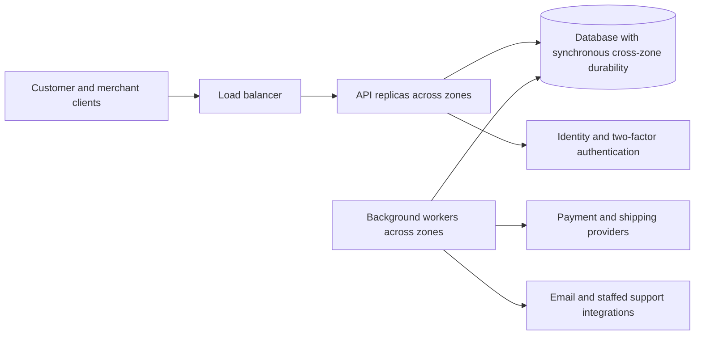

# ADR-002: Replicated modular monolith for CDC shop

**Status:** Accepted — option A.  
**Date:** 2026-10-29.  
**Source:** [CDC requirements](../data/CDC.txt) and [recorded discussion](CDC_architecture_adr_session_2026-10-29.md).

## Context

CDC is a production hardware shop serving customers in Slovakia, with merchant employees managing products and stock. It needs accounts, product browsing, carts, payments, refunds, shipment tracking, and customer contact.

| Driver | Requirement |
| --- | --- |
| Workload | Several thousand products; 30,000 API requests/day on average; up to 1,000 users/day. Peak request rate and concurrency are unknown. |
| Latency | p95 API response time of 200 ms. Proposed measurement: per ordinary read/write endpoint, including durable checkout acceptance, from API ingress to response under an agreed load. External payment/shipping completion is measured separately. |
| Availability | 99.9% over each calendar month. This explicitly replaces the earlier 30-minute monthly downtime cap. Unaffected shop functions must remain available when an external integration fails. |
| Durability | No acknowledged business-data loss on failure of one entire hosting zone (recovery point objective: zero for that failure scope). |
| Commerce | Track stock. Keep the price of existing cart items fixed while they remain in the cart and throughout ordering. Support refunds; delays in external processing are acceptable. |
| Security | Two-factor authentication is required; its implementation is deferred. Enforce customer ownership and merchant permissions. |
| Support | Contact form, displayed email address, and call-center contact when staff are available. AI chatbot is out of scope for now. |

For time-based availability, monthly downtime allowance = actual calendar-month duration × 0.001; a 30-day, 720-hour month permits 43.2 minutes. Proposed reporting uses calendar boundaries in Europe/Bratislava and measures critical journeys separately. A pending payment is not evidence that payment completion is available during a provider outage.

Planning assumptions, not additional accepted requirements: four engineers with shared operational responsibility; managed hosting in one European region across three zones; real payment/shipping providers; an initial 100 requests/second stress envelope; and a five-minute zone-recovery objective. Exact budget, peak traffic, measurement details, provider contracts, and return/cancellation rules remain open. Zero-loss recovery from an entire-region failure is outside the agreed failure scope.

## Decision

Adopt **A — a replicated modular monolith with separate background workers**. It keeps closely related commerce changes in local database transactions and has the lowest delivery and maintenance burden for the assumed team. The system remains distributed across API instances, workers, storage, and external providers.

Deploy stateless API replicas and separately scaled worker processes across zones. They use one application codebase and a highly available relational database. Each domain module owns its tables and exposes explicit operations to other modules. External calls run outside database transactions and outside the ordinary API request path where possible.

| Module or component | Responsibilities and requirement coverage |
| --- | --- |
| Accounts + identity provider | Registration, login, profiles, logout, two-factor authentication, roles and ownership checks: stories 1, 2, 3, 8, 13, 14, 19 |
| Catalog | Listing, details, name search, price sorting, merchant price changes, product creation and archival: stories 5, 6, 11, 12, 15, 16, 17, 18, 21, 22 |
| Cart, Stock, Order | Cart viewing/addition/clearing, price snapshots, stock reservations, order snapshots and checkout coordination: stories 4, 7, 24, 25 and added stock/price requirements |
| Payment and Shipment workers | Payment/refund attempts, provider callbacks, reconciliation, fulfillment and package information: stories 7, 9 and added refund requirements |
| Support + static content | Persisted contact submissions, email delivery/displayed address, staffed contact, About Us: stories 10, 20, 23; no chatbot |

### Transaction and failure behavior

- Store server-authoritative prices on cart lines and copy them into immutable order snapshots. Merchant edits affect new additions. Proposed rule for later quantity increases: new units receive a new price snapshot; existing units keep theirs. Archive removed products to preserve order history.
- A price guarantee does not reserve stock indefinitely. At checkout, atomically verify the cart version, reserve available stock, create the order and payment-attempt record, and insert an outbox entry. The outbox stores work in the same transaction as the order. Conditional stock updates prevent two checkouts from buying the last item; a unique checkout identifier prevents duplicate allocation.
- Workers process the outbox with bounded retries and stable operation identifiers. Record incoming callbacks durably, verify their authenticity, deduplicate them, and apply valid state transitions. Reconcile unknown outcomes against the provider. A successful provider operation followed by a local crash must recover the original operation, not create a new charge. Provider idempotency retention limits must inform retry rules. [Idempotency reference](https://docs.stripe.com/api/idempotent_requests), [callback reference](https://docs.stripe.com/webhooks).
- Release reservations on confirmed failure or cancellation according to an explicit lifecycle. Do not blindly release stock while payment status is unknown. A late successful payment after release requires safe re-reservation or a refund/exception workflow. Ship only after the required payment and stock conditions are recorded.
- Authorize refunds transactionally so successful plus pending refunds cannot exceed the paid amount. Track refund completion separately from return acceptance and restocking. There is no atomic database transaction spanning an external provider.

### Deployment, recovery, and security

Require synchronously durable commits across zones, safe promotion of a replica containing acknowledged changes, and fencing of the old writer. Never silently downgrade write acknowledgements to asynchronous durability. Retain sufficient application and database capacity after one zone fails. Durable outbox/inbox records must survive the same failure; caches are not authoritative. Provider and identity-service durability contracts also need review. Backups and restore drills address corruption and operator mistakes, but do not substitute for zone-loss durability. [Replication reference](https://www.postgresql.org/docs/current/warm-standby.html).

Use separate worker pools, bounded connection pools, timeouts, retry backoff, and circuit breakers so provider outages do not exhaust API resources. Show pending payment/shipment states honestly while browsing, cart access, and order-status access continue. Database quorum loss can block durable writes; identity-provider failure can block new login.

Enforce two-factor authentication, resource ownership, least-privilege merchant permissions, audited price/stock/refund changes, encrypted transport/storage, and managed secrets. Use provider-hosted/tokenized payment handling rather than retaining raw card details. Persist contact submissions before acknowledging them; email delivery may follow asynchronously.

Before production, validate per-endpoint p95 under realistic bursts, concurrent last-item checkout, price changes during checkout, duplicate refunds, worker crashes after provider success, duplicated/out-of-order callbacks, and dependency outages. Inject zone loss immediately after acknowledged writes and verify zero lost records plus recovery time; test authorization and backup restoration. Architecture acceptance is not evidence that these tests have passed.

## Alternatives Considered

### A — Replicated modular monolith with background workers — accepted

One modular application, replicated API/worker processes, and one highly available relational database; commerce invariants use local transactions.

**Pros:** simplest correctness model, few internal network calls, straightforward deployment and debugging, lowest maintenance burden for the assumed team.

**Cons:** shared releases and database increase the impact of defects; module boundaries, migrations, and resource isolation require discipline; multi-zone operation still has baseline cost.

**Reason accepted:** satisfies the required design boundaries with less coordination overhead than B or C at the stated scale, subject to validation of the chosen deployment.

### B — Commerce core plus independent integration and support services

Three services own separate databases: Commerce Core owns catalog/cart/stock/orders; Integration Service owns provider operations and shipment integration; Support Service owns contact workflows. Durable events connect local transactions.

**Pros:** preserves stock/order transactions while allowing independent support/integration deployment and resource isolation.

**Cons:** more deployments, stores, contracts, inboxes/outboxes, and reconciliation; order and provider-operation views can temporarily disagree; higher operating cost.

**Reason not selected:** independent integration/support deployment has not been established as worth the additional complexity. Reconsider if team ownership or release needs change.

### C — Domain microservices with a durable checkout workflow

Separate account, catalog, cart, inventory, order, payment/refund, fulfillment, and support services own their stores. A durable coordinator manages checkout steps and compensations through APIs/events.

**Pros:** strongest independent deployment and resource isolation; accommodates independently staffed domain teams.

**Cons:** cross-service stock/order coordination, extra network latency, complex recovery and observability, and many stores requiring zone resilience. Local transactions cannot commit the entire checkout atomically.

**Reason not selected:** current workload and team assumptions do not justify the implementation and operational burden. Reconsider for measured scaling or organizational needs.

## Score Matrix

Scores are reasoned judgments, not benchmarks: 1 = poor fit/high effort; 5 = excellent fit/low effort. Weights reflect correctness/recovery priorities and the assumed small team. Weighted score = sum(score × percentage weight) / 100. The availability revision and chatbot removal do not change the relative judgments.

| Criterion | Weight | A — accepted | B | C |
| --- | ---: | ---: | ---: | ---: |
| Stock, price, payment, and refund correctness | 30% | 5 | 5 | 3 |
| Zone recovery and zero-loss implementation effort | 20% | 4 | 4 | 3 |
| Implementation and deployment simplicity | 15% | 5 | 3 | 1 |
| Maintenance and operating cost | 15% | 5 | 3 | 2 |
| Failure isolation and independent evolution | 10% | 3 | 4 | 5 |
| Predictable p95 API latency | 10% | 4 | 4 | 3 |
| **Weighted total** | **100%** | **4.50** | **4.00** | **2.75** |

B preserves A's local commerce transactions but adds cross-service integration state. C's lower correctness/recovery scores reflect greater engineering effort, not impossibility. Security, availability, latency, and durability requirements remain pass/fail conditions; the total cannot compensate for failure to meet them. Frameworks, providers, and the precise database topology are implementation choices still to be validated.
